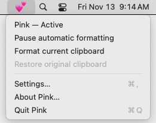
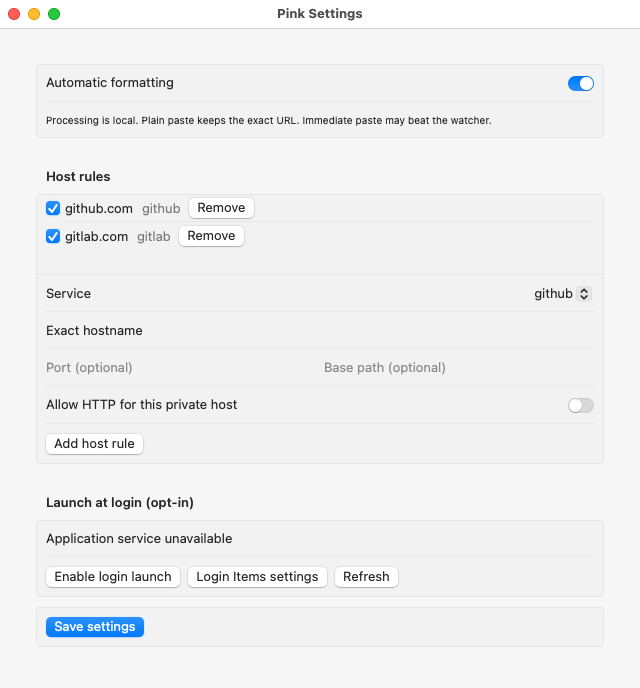

# Pink 💕

A native macOS 15+ menu-bar utility that adds short rich hyperlinks to copied GitHub and GitLab references, including multiple URLs within prose. The exact original text remains the plain-text representation.

`https://github.com/acme/widget/pull/123` → **acme/widget#123** in a rich-text receiver, linked to the original URL. Terminals and plain editors get the original URL. The receiver chooses; Pink never intercepts paste or inspects the destination.

For example, `Please review https://github.com/acme/widget/pull/123 and https://gitlab.com/team/project/-/merge_requests/45.` becomes “Please review **acme/widget#123** and **team/project!45**.” in rich text, with each short label linked to its original URL. Prose, repeated links, line breaks and nested parentheses are retained. Plain paste keeps the entire original message, including both full URLs.

<table>
  <tr><th>In the menu bar</th><th>Settings</th></tr>
  <tr>
    <td valign="top"></td>
    <td></td>
  </tr>
</table>

<sub>Actual Pink UI on macOS 15, using demo settings. Login availability depends on installation. [Capture details](docs/images/README.md).</sub>

Install with Homebrew (macOS 15+):

```sh
brew tap mamachanko/pink https://github.com/mamachanko/pink.git
brew install --cask mamachanko/pink/pink
```

This repository is the custom tap; no separate tap repository is required. The cask pins a reviewed release and SHA-256, and installs `Pink.app`. Use `brew upgrade --cask mamachanko/pink/pink` for updates and `brew uninstall --cask mamachanko/pink/pink` to remove it. Quit Pink and disable launch at login before uninstalling. `--zap` additionally removes current and legacy settings. See [Homebrew maintenance](docs/homebrew.md).

Or install a verified release ZIP or drag the app from the DMG to Applications, then open it and choose Enable. Default packages are **Ad-hoc signed; not Developer ID signed; not notarized.** macOS may block them. Review the source, build locally, or use the per-app Open Anyway option in Privacy & Security when offered. Never disable Gatekeeper globally. Developer ID releases require configured signing and notarization.

The 💕 menu provides Enable/Pause, Format current clipboard, safe Restore original clipboard, Settings, About and Quit. On activation it leaves existing content alone. Restore changes the current clipboard only. The app has no normal Dock icon. Launch at login is opt-in in Settings and may need approval in Login Items.

Supported HTTPS routes:

- GitHub `/owner/repo/pull/N`, `/owner/repo/issues/N`, with trailing slash or `files`, `commits`, `checks` review suffix.
- GitLab `/namespace/project/-/issues/N` and `/merge_requests/N`; merge requests also accept `diffs`, `commits`, `pipelines`. Nested namespaces are retained. Issues use `#`; merge requests use `!`.

Settings supports exact enterprise hosts, service, optional explicit port, installation prefix, enabled state and individual private-host HTTP opt-in. Rules cannot overlap. No wildcards or public-host HTTP. Prefixes are case-sensitive; host matching is case-insensitive. Explicit URL ports require matching explicit rule ports. Unicode names and unreserved percent escapes are supported; encoded separators are skipped. Query and fragment stay in the target.

Text is limited to 8 KiB per item. Bare URLs need clear boundaries such as whitespace or prose delimiters; named Markdown links and HTML source are not reformatted. Valid query/fragment punctuation is kept as part of the target.

All processing is local. No account, telemetry, servers, lookup, clipboard history or updater. Only settings are persisted. Unknown types, files/images, sensitive/temporary/generated/remote markers, multiple items, existing HTML/named rich links and mismatched representations are skipped. Unmarked sensitive content cannot be reliably identified. See [privacy](docs/privacy.md).

Initial consent is separate from OS privacy controls. On macOS 15.4+ Ask/Deny clipboard policies stop monitoring. Where provided, review System Settings → Privacy & Security → Paste from Other Apps, then use Retry. Pink does not request Accessibility, Input Monitoring or Screen Recording.

Polling runs about every 200 ms. Immediate paste can beat it; original URL is the fallback. Receivers may choose plain text or strip rich links; compatibility has **not been verified** on this Linux development host. See [actual compatibility status](docs/compatibility.md). External clipboard writes have an unavoidable race with clear/write. No atomicity claim.

Development requires Xcode 26.2 on macOS, Git, Node 24.22.1 and npm. Portable core can be tested on Linux with Swift 6.0+ (verified here using Swift 6.2). App runs without any of those tools or network.

```sh
make bootstrap  # npm ci; macOS builds pinned XcodeGen
make doctor     # print tools/architecture and missing native prerequisites
make lint       # Swift formatting, YAML/action pin checks, shell syntax
make test       # Swift tests (includes named AppKit tests on macOS), release-tool tests
make build      # universal app, local version 0.0.0/build 1
make package    # ad-hoc ZIP, drag-install DMG, manifest, checksums and verification
make verify     # lint + test + package
```

Build output lives in `build/`, artifacts in `dist/`; nothing installs automatically. App smoke mode `--smoke-test` exits before clipboard setup. Native tests use unique named boards, never your general clipboard. See [contribution](CONTRIBUTING.md), [architecture](docs/architecture.md), [verification](docs/verification.md), [requirements](docs/spec.md).

Releases use semantic-release on main after reusable verification; GitHub Releases are the changelog. See [release contract](docs/release.md) and [repository setup](docs/repository-setup.md). To uninstall: disable launch at login, quit, delete the app, then optionally remove its `io.github.mamachanko.pink` UserDefaults preferences. No clipboard history files exist.

Upgrading from the previous app name: Pink imports valid local settings once from the former preferences domain when Pink has no saved settings. No clipboard data is migrated. Quit the old app and disable its login item before removing it; enable launch at login for Pink separately if wanted. macOS may ask for clipboard access again for Pink’s new bundle identity.

If a mounted image or installed app still says RefPaste, check its version: v1.0.0 predates the rename. Eject that image and use a current [Pink release](https://github.com/mamachanko/pink/releases/latest). New package verification requires the volume and its sole application bundle to be named Pink. Historical release files are retained rather than silently replaced.
