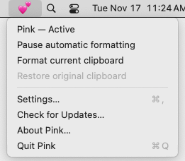
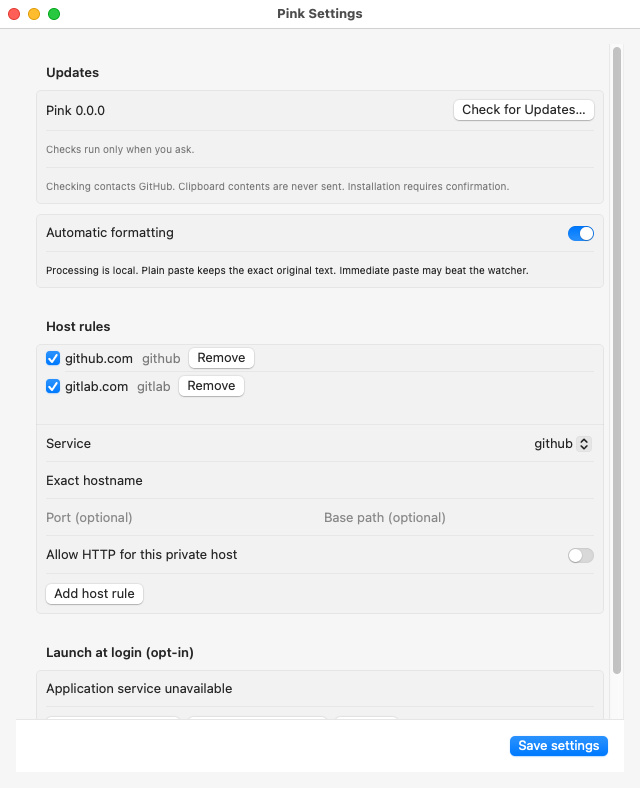
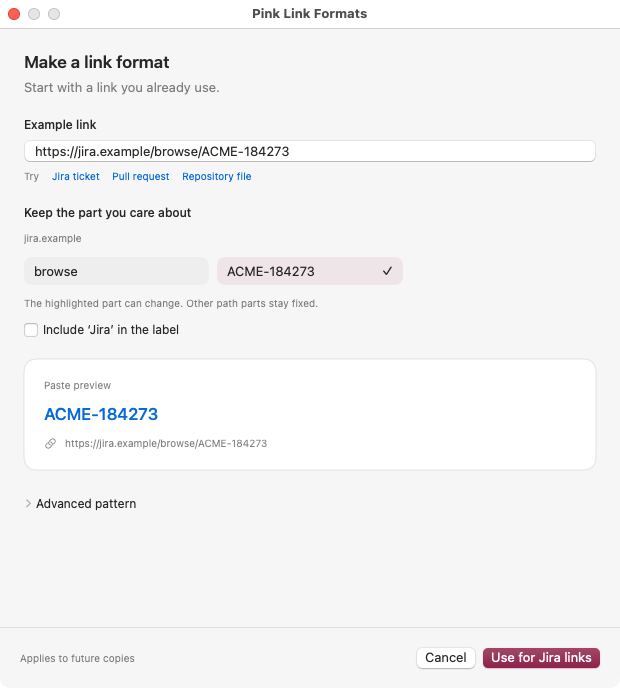

<h1 align="center">Pink 💕</h1>

<p align="center">
  <strong>Copy URLs. Paste links.</strong>
</p>

Pink makes long links easier to read in messages, notes and reviews. Copy normally; Pink adds short, clickable links alongside your untouched original text.

<table>
  <thead><tr><th>You copy</th><th>Rich-text paste</th></tr></thead>
  <tbody>
    <tr>
      <td><code>https://github.com/<wbr>acme/widget/<wbr>pull/123</code></td>
      <td><a href="https://github.com/acme/widget/pull/123"><strong>acme/widget#123</strong></a></td>
    </tr>
    <tr>
      <td><code>https://gitlab.com/<wbr>team/platform/api/<wbr>-/merge_requests/<wbr>45</code></td>
      <td><a href="https://gitlab.com/team/platform/api/-/merge_requests/45"><strong>team/platform/api!45</strong></a></td>
    </tr>
    <tr>
      <td><code>Please review https://github.com/<wbr>acme/widget/<wbr>pull/123 and https://gitlab.com/<wbr>team/project/<wbr>-/issues/7. Thanks!</code></td>
      <td>Please review <a href="https://github.com/acme/widget/pull/123"><strong>acme/widget#123</strong></a> and <a href="https://gitlab.com/team/project/-/issues/7"><strong>team/project#7</strong></a>. Thanks!</td>
    </tr>
    <tr>
      <td><code>https://github.com/<wbr>acme/widget</code></td>
      <td><a href="https://github.com/acme/widget"><strong>acme/widget</strong></a></td>
    </tr>
    <tr>
      <td><code>https://github.com/<wbr>acme/widget/blob/<wbr>main/Sources/App.swift#L10-L20</code></td>
      <td><a href="https://github.com/acme/widget/blob/main/Sources/App.swift#L10-L20"><strong>acme/widget · main/Sources/App.swift:10–20</strong></a></td>
    </tr>
    <tr>
      <td><code>https://github.com/<wbr>acme/widget/blob/<wbr>0123456789ab<wbr>cdef01234567<wbr>89abcdef01234567/<wbr>Sources/App.swift#L10-L20</code></td>
      <td><a href="https://github.com/acme/widget/blob/0123456789abcdef0123456789abcdef01234567/Sources/App.swift#L10-L20"><strong>acme/widget · 0123456789ab/Sources/App.swift:10–20</strong></a></td>
    </tr>
    <tr>
      <td><code>https://gitlab.com/<wbr>team/platform/api/<wbr>-/blob/<wbr>main/Sources/App.swift#L10-20</code></td>
      <td><a href="https://gitlab.com/team/platform/api/-/blob/main/Sources/App.swift#L10-20"><strong>team/platform/api · main/Sources/App.swift:10–20</strong></a></td>
    </tr>
    <tr>
      <td><code>https://github.com/<wbr>acme/widget/<wbr>releases/tag/v1.2.3</code></td>
      <td><a href="https://github.com/acme/widget/releases/tag/v1.2.3"><strong>acme/widget@v1.2.3</strong></a></td>
    </tr>
    <tr>
      <td><code>https://jira.example/<wbr>browse/ACME-184273</code></td>
      <td><a href="https://jira.example/browse/ACME-184273"><strong>ACME-184273</strong></a></td>
    </tr>
  </tbody>
</table>

The Jira example uses a [custom link format](#custom-link-formats-and-preview) for your installation. GitHub and GitLab presets work by default.

**Plain-text paste keeps the left column exactly.** A terminal or plain-text field can select the full original URLs and message. An app accepting rich text can select the right column, with every short label pointing to its original destination. Both representations are on the same clipboard item—your app chooses what to paste.

Pink works with single links, repeated links and multiline prose. It stays in your menu bar, runs locally, and never intercepts your paste shortcut. [How paste formats work](docs/architecture.md#urls-embedded-in-prose).

<p align="center">
  <a href="https://github.com/mamachanko/pink/actions/workflows/ci.yml"></a>
  &nbsp; macOS 15+ &nbsp;·&nbsp; Apple Silicon &amp; Intel &nbsp;·&nbsp; <a href="LICENSE">MIT</a>
</p>

<p align="center">
  <a href="#installation">Install</a> ·
  <a href="#usage">Usage</a> ·
  <a href="#supported-links">Supported links</a> ·
  <a href="#development">Development</a>
</p>

<table align="center">
  <tr><th>In the menu bar</th><th>Your link formats</th></tr>
  <tr>
    <td align="center" valign="top"><a href="docs/images/menu-bar.png"><picture><source media="(prefers-color-scheme: dark)" srcset="docs/images/dark/menu-bar.png"></picture></a></td>
    <td align="center" valign="top"><a href="docs/images/settings.png"><picture><source media="(prefers-color-scheme: dark)" srcset="docs/images/dark/settings.png"></picture></a></td>
  </tr>
</table>

<p align="center">
  <a href="docs/images/link-formats.png"><picture><source media="(prefers-color-scheme: dark)" srcset="docs/images/dark/link-formats.png"></picture></a>
</p>

<p align="center"><sub>Actual Pink UI on macOS with demo settings. <a href="docs/images/README.md">Capture details</a>.</sub></p>

## Installation

Requires **macOS 15 or later**. Each release contains a universal app for Apple Silicon and Intel.

### Homebrew

```sh
brew tap mamachanko/pink https://github.com/mamachanko/pink.git
brew install --cask mamachanko/pink/pink
```

Update with `brew upgrade --cask mamachanko/pink/pink`. The custom tap lives in this repository and follows reviewed, checksum-pinned releases. Automation keeps one update PR current and starts its checks automatically; a direct download may be newer while that PR awaits merge.

### Direct download

Download a ZIP or DMG from [GitHub Releases](https://github.com/mamachanko/pink/releases/latest). Extract the ZIP or drag **Pink.app** from the DMG into **Applications**, then open it.

> [!IMPORTANT]
> Current packages are **Ad-hoc signed; not Developer ID signed; not notarized.** If macOS blocks launch, use the per-app **Open Anyway** option in **Privacy & Security** when offered, or [build from source](#development). Keep Gatekeeper enabled. See the [installation guide](docs/installation.md) for details.

## Usage

1. Open Pink and choose **Enable** to allow local clipboard processing.
2. Copy a supported URL, or text containing several supported URLs.
3. Paste normally. Your app chooses whether to use rich or plain text.

Pink lives in the menu bar, with no Dock icon. Its menu gives you:

| Action | What it does |
| --- | --- |
| **Pause automatic formatting** | Stop processing new copies. Enable it again to resume. |
| **Format current clipboard** | Process content you already copied. |
| **Restore original clipboard** | Restore the last original item while Pink still owns the current clipboard. It cannot change text already pasted. |
| **Settings** | Manage and preview all link formats in one collection; choose automatic formatting and opt-in launch at login. macOS may require login-item approval. |
| **Check for Updates…** | Check for a newer release and choose whether to update. Also available in Settings. |

Enabling or resuming Pink leaves existing clipboard content alone. Use **Format current clipboard** to process it explicitly.

A message containing a pull request and a merge request can appear as:

> Please review [acme/widget#123](https://github.com/acme/widget/pull/123) and [team/project!45](https://gitlab.com/team/project/-/merge_requests/45).

Each label keeps its own destination. Plain paste retains the entire original message, including both full URLs.

### Links copied from chat or a browser

Turn on **Settings → General → Rewrite already-formatted URLs**, then **Save settings**. Copy the message again, or choose **Format current clipboard**.

For example, a clickable `https://github.com/acme/widget/pull/123` can become [acme/widget#123](https://github.com/acme/widget/pull/123), even when copied from another message. The visible URL must match its destination. Messages containing deliberately named links stay unchanged, and plain paste always keeps the exact original text.

This option is off by default. It can simplify rich formatting and accepts only a conservative set of HTML fragments. Images, attachments, unknown clipboard types and conflicting representations remain ineligible. It never opens or fetches copied HTML resources.

### Updating Pink

Open **Settings → General → Check for Updates…**, or use the same action in the menu. Pink reports when you’re up to date and lets you retry if the check fails. Checks contact GitHub only when you ask; they never send clipboard contents.

Releases configured for signed in-app updates offer **Install Update**, then restart Pink using Sparkle’s native update dialog. Builds without update-signing configuration offer the release download for manual installation. Homebrew users can continue using `brew upgrade --cask mamachanko/pink/pink`. See [update delivery and setup](docs/updates.md).

## Supported links

`github.com` and `gitlab.com` are enabled by default over HTTPS. The GitHub bundle includes repositories, issues, pull requests, files, file permalinks and releases together; no per-kind setup is needed. Each website row lists its included formats. **More → Customize built-in styles** changes their appearance. Existing disabled website rules and saved custom rules are retained. Explicitly preferred custom patterns still take priority.

| Service | URL path | Short label |
| --- | --- | --- |
| GitHub issue | `/owner/repo/issues/123` | `owner/repo#123` |
| GitHub pull request | `/owner/repo/pull/123` | `owner/repo#123` |
| GitHub repository | `/owner/repo` | `owner/repo` |
| GitHub file | `/owner/repo/blob/main/Sources/App.swift#L10-L20` | `owner/repo · main/Sources/App.swift:10–20` |
| GitHub file permalink | `/owner/repo/blob/0123456789abcdef0123456789abcdef01234567/Sources/App.swift#L10` | `owner/repo · 0123456789ab/Sources/App.swift:10` |
| GitHub release | `/owner/repo/releases/tag/v1.2.3` | `owner/repo@v1.2.3` |
| GitLab file / permalink | `/group/project/-/blob/main/Sources/App.swift#L10-20` | `group/project · main/Sources/App.swift:10–20` |
| GitLab issue | `/group/project/-/issues/123` | `group/project#123` |
| GitLab merge request | `/group/project/-/merge_requests/123` | `group/project!123` |

Nested GitLab namespaces stay in the label. Trailing slashes are supported, along with GitHub `files`, `commits` and `checks` subpages and GitLab merge-request `diffs`, `commits` and `pipelines` subpages. Queries, fragments and display case are preserved.

File links work on GitHub.com, configured GitHub Enterprise installations, GitLab.com and configured GitLab installations. GitHub line anchors (`#L10`, `#L10-L20`) and GitLab anchors (`#L10`, `#L10-20`, `#L10-L20`) appear as `:10` or `:10–20`. Positive, ordered ASCII line numbers are recognized. Other fragments stay in the destination without a line suffix.

Files keep the revision and path together because branch names can contain slashes. Full 40- or 64-character hexadecimal revisions are displayed with their first 12 characters; the complete URL, revision, query and fragment remain the link destination. Pink never looks up repository data. Tagged releases are supported; `/releases/latest` and directory (`tree`) URLs stay unchanged.

### Custom link formats and preview

Settings follows your Mac’s light or dark appearance. It uses a rose accent for primary actions, native switches, and bordered options buttons. Use the **Link formats / General** selector at the top to switch sections.

Open **Settings → Link formats → Add format** and paste a link you already use. Pink suggests the useful part and shows the resulting hyperlink immediately.

For a Jira issue:

1. Paste `https://jira.example/browse/ACME-184273` (using your installation’s hostname).
2. Pink highlights `ACME-184273` and previews it as a short, clickable link.
3. Optionally select a different part or include “Jira” in the label.
4. Choose **Use for Jira links**. The format applies immediately; **Undo** is available in the formats list.

There is no second Save step. A link that already works, including built-in GitHub references, shows its current result and offers **Done** without adding another rule. Choose **Choose a different look** to customize it. You can also paste into the shared **Try a link** preview and choose **Make a format for this link** when it has no match.

The preview uses the clipboard matcher, including existing rules and priority. The highlighted part becomes variable; other path parts remain fixed. Known GitHub suggestions also generalize owner/repository fields and keep file revision/path or release tags together. Only the confirmed format is saved; the example is not kept as a separate record. Queries, fragments, display case and the original destination remain exact.

Try another example to check the same format: Pink keeps your chosen part and context when it matches. Advanced pattern and label edits stay in place even for a nonmatching example; **Suggest from this link** explicitly starts a fresh suggestion.

**Advanced pattern** exposes the name, URL pattern, label and priority for unusual cases. `{issue}` captures one path segment; a final `{path...}` captures one or more remaining segments and appears as `{path}` in the label. Captures occupy whole segments and have unique letter-first names. Matching uses an exact host, scheme and optional port with case-sensitive path literals. Pattern literals support valid unreserved escapes, UTF-8 and encoded filename spaces; encoded separators, dot segments, malformed escapes and controls are rejected. Patterns cannot contain queries, fragments or user regex.

Click a format in the list to edit it, use its switch to enable or disable it, or open its options menu to remove it or move a pattern earlier/later. Removing a format asks for confirmation. The **More** menu beside **Add format** keeps custom starter templates and GitHub/GitLab installation settings available. Existing settings, enterprise hosts and disabled rules are preserved. Customizing an existing look explicitly gives the new pattern priority; exact-pattern edits reuse the existing rule, and Undo restores its earlier value and priority. Undo remains available until another format changes. If saving fails, the draft stays open and previous settings remain active.

The builder supports at most 64 custom rules. The visual builder asks for a per-host confirmation before saving an HTTP format; an HTTP pattern entered in the advanced editor also explicitly opts that host into HTTP; public GitHub and GitLab hosts require HTTPS. Matching and label generation stay local. Labels are plain text escaped for rich output, and rules never rewrite destinations or run scripts. In prose, trailing sentence punctuation outside a query or fragment stays outside the hyperlink; encode a literal trailing path punctuation character when needed. A whole-URL item always keeps its exact valid target.

### Enterprise installations

Choose **Settings → Link formats → More beside Add format → GitHub or GitLab installation…** for your installation. Website formats support an exact hostname and enabled state, with an optional port, installation base path and HTTP opt-in under **Advanced**. They appear alongside every other format in the same collection. HTTP requires an explicit opt-in for that particular private host; HTTPS remains the default. Wildcards and overlapping enabled rules are rejected. See [matching rules](docs/architecture.md) for port and path-boundary details.

## Privacy and permissions

Clipboard processing stays on your Mac. Pink has no accounts, telemetry, repository lookups or clipboard history. Update checks and downloads contact GitHub only after you request them. Clipboard contents and the single temporary restoration snapshot are never logged, persisted or sent. Settings (including configured patterns and labels) and update preferences are saved locally. Example URLs are never saved.

Pink does not need Accessibility, Input Monitoring or Screen Recording permissions. Its initial **Enable** consent is separate from macOS clipboard policy. On macOS 15.4+, an Ask/Deny policy stops monitoring; review the per-app **Paste from Other Apps** setting where available, then use **Retry**. See [privacy](docs/privacy.md) and [permission guidance](docs/installation.md#clipboard-permissions).

## Limitations

- **Paste behavior depends on the app.** An app can select plain text or strip links. App-specific compatibility has not yet been manually verified; see the [compatibility record](docs/compatibility.md).
- **An immediate paste can beat the watcher.** Pink checks about every 200 ms. The safe fallback is your original text. It never intercepts paste, simulates keys or inspects the destination app.
- **Some clipboard items are deliberately skipped.** These include files, images, multiple items, unknown types, protected/temporary/generated/remote markers and named hyperlinks. Existing HTML is skipped unless the optional formatted-URL setting can safely validate it. Unmarked sensitive content cannot always be identified.
- **Text is limited to 8 KiB per item.** Bare URLs need clear boundaries. Named Markdown destinations and HTML source are not reformatted; ambiguous adjacent URLs are left unchanged. Existing raw RTF links must agree with the proposed targets.

Clipboard writes also have a small, unavoidable race with other applications. Pink checks for changes before writing and before offering restoration. The [architecture notes](docs/architecture.md) describe that boundary.

## Development

Build prerequisites: **Xcode 26.2**, **Node.js 24.22.1**, npm and Git. The installed app runs without those tools or network access.

```sh
git clone https://github.com/mamachanko/pink.git
cd pink
make bootstrap
make doctor
make verify
```

| Command | Purpose |
| --- | --- |
| `make bootstrap` | Install pinned build and verification tools. |
| `make doctor` | Check prerequisites and print architecture/toolchain versions. |
| `make lint` | Check Swift formatting, workflows and shell scripts. |
| `make test` | Run Swift and release-tooling tests; include named AppKit pasteboards on macOS. |
| `make build` | Build the universal app with local version `0.0.0`. |
| `make package` | Create and verify an ad-hoc ZIP, DMG, checksums and build manifest. |
| `make verify` | Run lint, tests and packaging together. |

Builds go to `build/` and packages to `dist/`; these commands do not install the app. The Foundation-only core also supports portable testing on Linux with Swift 6.0+ (verified with Swift 6.2). Native tests use unique named pasteboards, never the general clipboard; smoke mode `--smoke-test` exits before clipboard setup.

Contributions are welcome. Start with [CONTRIBUTING.md](CONTRIBUTING.md), then see the [architecture](docs/architecture.md), [requirements](docs/spec.md) and [verification results](docs/verification.md). Report vulnerabilities using [SECURITY.md](SECURITY.md).

Dependency updates run nightly at 02:17 UTC through the [Renovate workflow](.github/workflows/renovate.yml), using GitHub’s built-in token, with a manual run option; see [setup and migration](docs/repository-setup.md#nightly-renovate).

Releases are automated with semantic-release after verification. [GitHub Releases](https://github.com/mamachanko/pink/releases) are the changelog. Maintainers can find the [release process](docs/release.md), [Homebrew maintenance](docs/homebrew.md) and [repository setup](docs/repository-setup.md) in `docs/`.

## Uninstall

Disable **launch at login** in Settings and quit Pink, then run:

```sh
brew uninstall --cask mamachanko/pink/pink
```

For a manual installation, delete **Pink.app**. Ordinary uninstall preserves preferences and update caches; use Homebrew’s `--zap` only if you also want to remove them. See [removal and legacy upgrades](docs/installation.md#uninstall) for details.

## License

Pink is available under the [MIT License](LICENSE).
